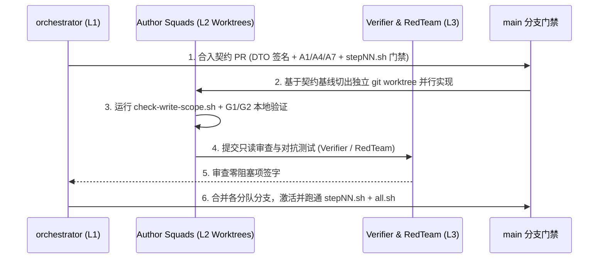

# 多代理分队协同、写入边界与 Worktree 隔离宪章

本文档规定 `rtkk` 多代理研发团队的五类一级角色职责、独占文件写入路径白名单、L3 验证子代理职责分离纪律，以及同机多 `git worktree` 并发端口与沙盒隔离规范。

---

## 1. 五大分队角色与独占写入白名单

任何非 `orchestrator` 分队仅允许修改所属白名单路径内的文件。合流前由 [scripts/check-write-scope.sh](../scripts/check-write-scope.sh) 自动校验 `git diff --name-only`，越界修改直接返回非 `0` 阻断合入：

| 角色标识（`--role`） | 角色定位 | 独占写入路径白名单 |
| :--- | :--- | :--- |
| `orchestrator` | **L1 架构总控与契约官** | `IRON_RULES.md`、`AGENTS.md`、`GEMINI.md`、`CLAUDE.md`、`.gitignore`、`README.md`、`OPERATION_GUIDE.md`、`Cargo.toml`、`Cargo.lock`、`rust-toolchain.toml`、`build.rs`、`src/lib.rs`、`src/main.rs`、`src/cli.rs`、`src/error.rs`、`src/daemon/mod.rs`、`src/daemon/state.rs`、`src/daemon/routes/mod.rs`、`web/package.json`、`web/package-lock.json`、`web/tsconfig.json`、`web/vite.config.ts`、`web/src/App.tsx`、`web/src/lib/api/enums.ts`、`web/src/modules/registry.ts`、`.github/`、`docs/`、`plans/`、`scripts/*.py`、`scripts/check-write-scope.sh`、`scripts/gate/lib.sh`、`scripts/gate/all.sh` |
| `squad-engine` | **L2 核心编排引擎分队** | `src/cert.rs`、`src/prep.rs`、`src/utils.rs`、`src/workspace.rs`、`src/connector/`、`src/inventory/`、`src/logging/`、`src/playbook/`、`src/registry/`、`src/tasks/`、`src/template/`、`src/workspace/` |
| `squad-daemon` | **L2 常驻服务与接口分队** | `src/daemon/auth.rs`、`src/daemon/jobs.rs`、`src/daemon/mask.rs`、`src/daemon/sse.rs`、`src/daemon/embed.rs`、`src/daemon/routes/`（严禁修改 `src/daemon/routes/mod.rs`） |
| `squad-web` | **L2 Park UI 前端分队** | `web/AGENTS.md`、`web/index.html`、`web/src/components/`、`web/src/pages/`、`web/src/styles/`、`web/src/hooks/`、`web/src/lib/`（严禁修改 `web/src/App.tsx`、`web/src/lib/api/enums.ts`、`web/src/modules/registry.ts`） |
| `squad-ops-qa` | **L2 部署配置与门禁分队** | `configs/`、`deploy/`、`test/`、`web/e2e/`、`web/playwright.config.ts`、`scripts/gate/step*.sh`、`scripts/gate/vps-cluster-e2e.sh` |

---

## 2. 四步契约先行流水线（Contract-First Workflow）

每个 Stage B 功能步骤（Step 01 ～ Step 07）均严格按以下四步推进，严禁在契约未落盘前跨分队盲写实现：



### L3 专项子代理职责分离纪律

在复杂模块交付与合流审查阶段，内部验证角色与编码角色严格职责分离：
1. **Research（只读调研）**：梳理存量调用链、边缘条件与外部协议规范，不修改工作区文件。
2. **Author（分队实现）**：在各自 `git worktree` 白名单目录内编写业务代码与单元/集成测试。
3. **Verifier（独立验证）**：在只读视角核对实现是否满足 `IRON_RULES.md`、契约字段签名与 Rustdoc 完整性，不得直接替 Author 改码掩盖缺陷。
4. **RedTeam（安全与边界对抗）**：重点针对路径穿越、未授权绕过、脱敏漏网、并发写竞争、SSE 断连资源泄漏、暗色模式低对比度与离线断网请求执行逆向挑刺。

---

## 3. Git Worktree 物理隔离规范

并行推进多个分队任务时，必须在主仓库平级目录创建独立 `git worktree`，严禁多个代理在同一工作树并发切换分支或争抢文件锁：

```bash
# 示例：为 Step 04 并行拉起 daemon、web、ops-qa 三个物理隔离工作树
git worktree add ../rtkk-wt-slot1 -b feat/s04-daemon main
git worktree add ../rtkk-wt-slot2 -b feat/s04-web main
git worktree add ../rtkk-wt-slot3 -b feat/s04-ops-qa main

# 合流验收完毕后清理工作树
git worktree remove ../rtkk-wt-slot1
git worktree remove ../rtkk-wt-slot2
git worktree remove ../rtkk-wt-slot3
```

---

## 4. 同机并发测试端口槽与工作区隔离表（`WT_SLOT`）

`rtkk` Daemon 生产与主门禁默认端口全局锁定为 **`19912`**。同机多 `git worktree` 并行运行门禁脚本时，通过环境变量 `WT_SLOT` 自动偏移监听端口与工作目录（由 [scripts/gate/lib.sh](../scripts/gate/lib.sh) 统一计算导出）：

| 槽位标识 | 环境变量 | 计算公式 | Daemon 绑定地址（`RTKK_BIND_ADDR`） | 隔离工作目录（`RTKK_WORK_DIR`） |
| :--- | :--- | :--- | :--- | :--- |
| 主门禁槽（串行 `all.sh`） | `WT_SLOT=0`（默认） | `19912 + 0 * 10000` | `127.0.0.1:19912` | `.gate/work-slot0` |
| 并发槽 #1 | `WT_SLOT=1` | `19912 + 1 * 10000` | `127.0.0.1:29912` | `.gate/work-slot1` |
| 并发槽 #2 | `WT_SLOT=2` | `19912 + 2 * 10000` | `127.0.0.1:39912` | `.gate/work-slot2` |
| 并发槽 #3 | `WT_SLOT=3` | `19912 + 3 * 10000` | `127.0.0.1:49912` | `.gate/work-slot3` |
| 并发槽 #4 | `WT_SLOT=4` | `19912 + 4 * 10000` | `127.0.0.1:59912` | `.gate/work-slot4` |

> [!IMPORTANT]
> 门禁脚本内任何辅助本地 Mock HTTP / OCI Registry 服务必须绑定 `127.0.0.1:0`（由内核分配空闲临时端口后再写回测试配置），严禁硬编码固定辅助端口造成多槽位并发冲突。
