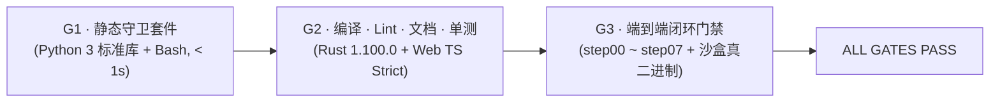

# 质量门禁与三级验证宪章（G1 / G2 / G3）

本文档定义 `rtkk` 跨阶段恒定生效的三级自动化质量门禁标准。所有本地提交、Git Worktree 分队交付物及 GitHub Actions Debian 13 CI 流水线均遵循同一套验证矩阵，严禁跳过或弱化任一检查项。

---

## 1. 三级门禁架构总览



| 层级 | 门禁定位 | 执行载体 | 失败处置 |
| :--- | :--- | :--- | :--- |
| **G1** | 代码豁免拦截、前端红线扫描、YAML 权限审计、文档死链核验、路由与需求双向对齐、分队写入锁 | `scripts/*.py` + `scripts/check-write-scope.sh` | 毫秒级阻断，禁止进入编译环节 |
| **G2** | Rust 格式、Clippy 全量 `deny`、零警告 Rustdoc、53+ 单元/集成测试；Web TS 严格类型检查与 Vite 离线打包 | `cargo`（`1.100.0`）+ `npm`（当 `web/` 已初始化时） | 阻断构建产物生成 |
| **G3** | 对真实编译出的 `rtkk` 二进制（及容器镜像）在隔离沙盒目录与并发端口槽内执行黑盒业务断言 | `scripts/gate/step00.sh` ～ `step07.sh` | 阻断分支合流与发版 |

---

## 2. G1 静态守卫矩阵

全部 G1 脚本仅依赖 Python 3 标准库与 POSIX/Bash 工具，零第三方包依赖，单轮串行耗时 `< 1s`：

| 脚本路径 | 校验范围与阻断规则 |
| :--- | :--- |
| [scripts/lint-guard.py](../scripts/lint-guard.py) | 核验 `rust-toolchain.toml` 与 `Cargo.toml` 锁定 `1.100.0` 及 `edition = "2024"`；核验 `[workspace.lints]` 中 `unsafe_code = "forbid"` 及全部 `deny` 规则未遭篡改；剥离注释与字符串后扫描 `src/**/*.rs`、`test/**/*.rs`、`build.rs`，拦截 `unsafe`、`#[allow`、`# | `web/src` 未初始化时快速跳过返回 `0`；初始化后拦截 `: any`、`as any`、`<any>`、`@ts-ignore`、`@ts-expect-error`、`eslint-disable`、原生 `<select`、`alert(`、`confirm(`、`prompt(`、外部 `http(s)://` 样式/字体/脚本 CDN，校验 `tokens.css` 包含 `[hidden]` 与 `:root` / `[data-theme="dark"]` 双色高对比度定义及简练控件微文案 |
| [scripts/configs-guard.py](../scripts/configs-guard.py) | 扫描 `configs/` 与 `deploy/` 下全部 `.yaml` / `.yml`：拦截制表符缩进污染；强制所有任务 `mode:` 字段值为引号包裹的字符串（如 `mode: "0600"`）；强制私库凭据 `hosts.toml` 声明 `mode: "0600"`；核验示例配置口令保持安全占位符 |
| [scripts/docs-and-plans-guard.py](../scripts/docs-and-plans-guard.py) | 强制 `IRON_RULES.md`、`AGENTS.md`、`GEMINI.md`、`CLAUDE.md`（及 `web/AGENTS.md`）单文件 `< 24,000` 字节；解析全仓 `.md`（跳过代码块）相对路径链接并校验目标真实存在；扫描现态文档反模式与无关项目残留词 |
| [scripts/check_routes.py](../scripts/check_routes.py) | 提取 `src/daemon/routes/**/*.rs` 全部已挂载 `(METHOD, /api/v1/...)` 路由对，与 [A4-API-CONTRACT-INDEX.md](./standards/A4-API-CONTRACT-INDEX.md)「已挂载路由表」执行双向集合等价核验 |
| [scripts/check_traceability.py](../scripts/check_traceability.py) | 解析 [A7-REQUIREMENTS-TRACEABILITY.md](./standards/A7-REQUIREMENTS-TRACEABILITY.md) 中全部 ``stepNN `"assertion-name"` `` 标记，校验对应 `scripts/gate/stepNN.sh` 真实包含同名断言调用 |
| [scripts/check-write-scope.sh](../scripts/check-write-scope.sh) | 按 `--role <role>` 比对当前分支变更文件是否越出 [MULTI_AGENT_TEAM_WORKFLOW.md](./MULTI_AGENT_TEAM_WORKFLOW.md) 授权路径白名单；提供 `--self-test` 内置正反例自检 |

---

## 3. G2 编译、文档与单测标准

### 3.1 Rust 核心与 Daemon（全阶段必跑）

```bash
source "$HOME/.cargo/env"
cargo fmt --all -- --check
cargo clippy --workspace --all-targets --locked -- -D warnings
RUSTDOCFLAGS='-D warnings' cargo doc --workspace --no-deps --locked
cargo test --workspace --locked
```

### 3.2 Park UI 前端工程（当 `web/package.json` 存在时自动激活）

```bash
cd web
npm run typecheck
npm run build
```

要求 TypeScript 严格模式零报错，Vite 构建产物输出至 `web/dist/`，且 `build.rs` 重新编译 `rtkk` 后零警告完成 Gzip 与 SHA256 ETag 静态内嵌。

---

## 4. G3 端到端闭环门禁规范（`step00` ～ `step07`）

### 4.1 门禁脚本清单与阶段激活演进

所有 G3 脚本统一引用 [scripts/gate/lib.sh](../scripts/gate/lib.sh)，运行于 `.gate/tmp-stepNN-slot${WT_SLOT}/` 独立沙盒并在退出时由 `trap` 自动清理后台进程与临时文件：

| 门禁脚本 | 所属阶段 | 覆盖能力编号 | 核心黑盒验收闭环 |
| :--- | :--- | :--- | :--- |
| [scripts/gate/step00.sh](../scripts/gate/step00.sh) | Stage A（默认激活） | `C01`、`C07`、`C14` | `rtkk --version` 对齐 `Cargo.toml`；99 年 CA 与叶证书签发、`0600` 私钥权限与链校验；本地 Playbook 双次幂等执行；非法拓扑与 `--forks 0` 快速失败 |
| [scripts/gate/step01.sh](../scripts/gate/step01.sh) | Stage B · Step 01 | `C15`、`C16` | 多并发任务 `EventSink` 与实例级 `TemplateRegistry` 零串扰；空目录 `Workspace::ensure_initialized` 释放默认 `configs/` 且幂等保留用户改动 |
| [scripts/gate/step02.sh](../scripts/gate/step02.sh) | Stage B · Step 02 | `C17`、`C18`、`C19` | `rtkk serve` 与 `rtkk healthcheck` 探活；未登录 `401` 拦截与令牌登录 Cookie/Bearer 会话；变更任务单飞 `409` 互斥锁；SSE 历史 JSONL 回放与实时流 |
| [scripts/gate/step03.sh](../scripts/gate/step03.sh) | Stage B · Step 03 | `C20` | `web-guard.py` + `typecheck` + `vite build`；重编单二进制后验证 `/` 与深层前端路由返回内嵌 SPA、`Accept-Encoding: gzip` 压缩及 `If-None-Match` `304` 缓存 |
| [scripts/gate/step04.sh](../scripts/gate/step04.sh) | Stage B · Step 04 | `C21`、`C22`、`C23` | Inventory 读取 `********` 脱敏与未改密文无损回写、`auth_basic` 自动重算；`public_registries_insecure` 双栈免证书 `hosts.toml`；6 大 `.gtmpl` 节点实时预览 |
| [scripts/gate/step05.sh](../scripts/gate/step05.sh) | Stage B · Step 05 | `C24`、`C25` | 离线目录状态清点对齐 `inventory.yaml` 与 `images.yaml`；本地模拟 OCI + Harbor v2 服务完成 `registry/ping`、`pull`、`push` 全链路异步同步 |
| [scripts/gate/step06.sh](../scripts/gate/step06.sh) | Stage B · Step 06 | `C26`、`C27` | Playbook 大纲解析与带 `tags` 异步编排执行；PKI API 签发 99y/1y 证书、SAN 元数据读取（零私钥泄露）与链核验；`rtkk_bak/` 流式 `.tar.gz` 归档下载 |
| [scripts/gate/step07.sh](../scripts/gate/step07.sh) | Stage B · Step 07 | `C28`、`C29` | Playwright 纯离线断网拦截下验证 Light/Dark `>= 4.5:1` 对比度、零 `<select>`、全键盘无障碍、`<768px` 零横向溢出与全业务旅程；`deploy/compose/`（`:19912`）容器启停验收 |
| [scripts/gate/vps-cluster-e2e.sh](../scripts/gate/vps-cluster-e2e.sh) | 虚拟 VPS 联调门禁 | `C01`～`C29` 实机联调 | 当 Debian 13 虚拟 VPS 集群就绪并传入 `RTKK_VPS_INVENTORY` 时执行：真实 SSH/`sudo`/`su` 探活、Harbor 同步、DNS 劫持镜像拉取、高可用 K8s 部署、备份回收与重置闭环 |

### 4.2 脚本输出契约

1. 单项断言统一通过 `run_assertion "<assertion-name>" <fn_or_cmd>` 执行，输出 `PASS [stepNN] <assertion-name>` 或 `FAIL [stepNN] <assertion-name>`。
2. 每个 `stepNN.sh` 全部断言通过后，标准输出最后一行精确打印：
   ```text
   GATE stepNN PASS
   ```
3. 总入口 [scripts/gate/all.sh](../scripts/gate/all.sh) 按顺序串联 G1 → G2 → 当前已交付阶段的激活 G3 列表（可通过 `RTKK_ACTIVE_GATES="step00 step01 ..."` 扩展，随 Stage B 各 Step 合入逐步递增至 `step00..step07`），全部通过后标准输出最后一行精确打印：
   ```text
   ALL GATES PASS
   ```

---

## 5. Debian 13 容器化 CI 一致性

GitHub Actions（[.github/workflows/ci.yml](../.github/workflows/ci.yml)）在每次 `push` 与 `pull_request` 时拉取最新 `debian:13` 官方镜像，调用 [.github/scripts/release/debian13-build.sh](../.github/scripts/release/debian13-build.sh) 在纯净 Debian 13 `x86_64` 环境内完整执行 `bash scripts/gate/all.sh`，确保本地开发门禁与 Linux 生产目标发行版 100% 同构。
