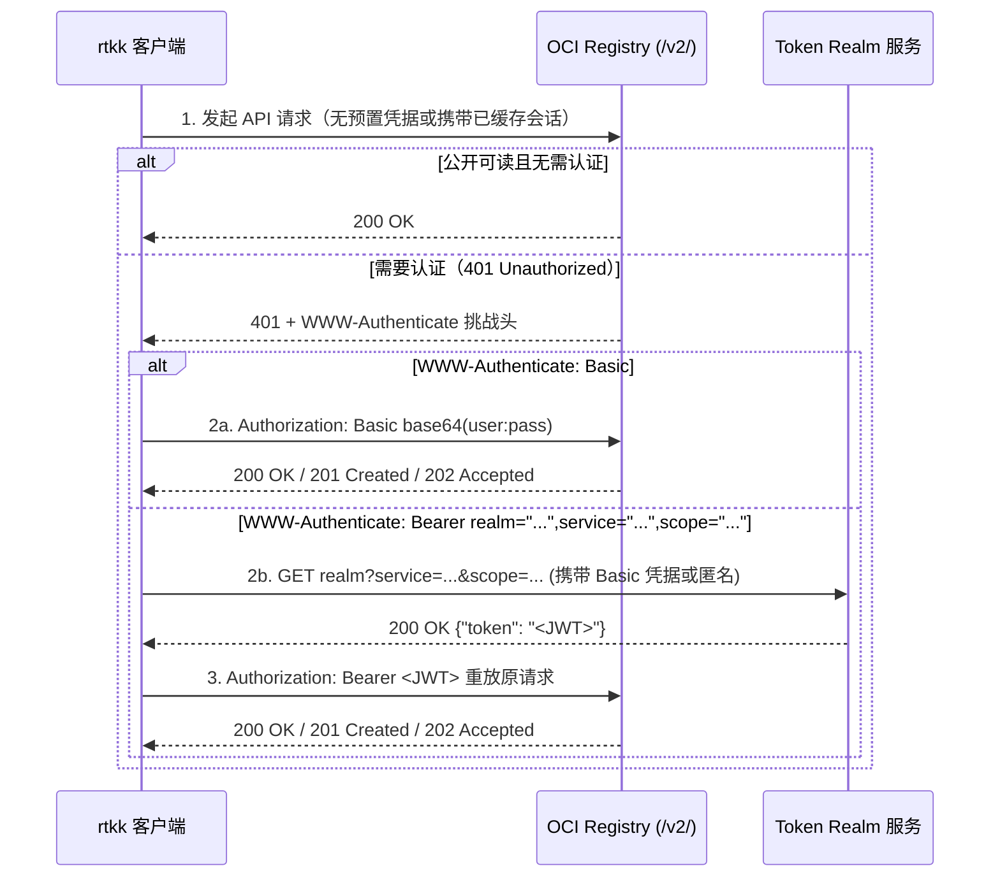

# 镜像仓库认证与 Harbor 权限配置指南

> [!NOTE]
> 本文档是 [运维准备与安全建议手册](../OPERATION_GUIDE.md) 的配套技术指南，详细说明 `rtkk` 在 OCI Distribution v2 协议下的认证协商机制、Harbor v2 项目可见性控制、Robot Account 最小权限配置以及 Debian 13 (`Trixie`) 节点侧 `containerd` 私有拉取配置。

---

## 目录

- [1. OCI Distribution v2 认证协商机制](#1-oci-distribution-v2-认证协商机制)
- [2. Harbor v2 项目自动创建与可见性控制](#2-harbor-v2-项目自动创建与可见性控制)
- [3. Harbor Robot Account 最小权限实践（Debian 13）](#3-harbor-robot-account-最小权限实践debian-13)
- [4. Kubernetes 节点 `containerd` 私有拉取与 `0600` 权限加固](#4-kubernetes-节点-containerd-私有拉取与-0600-权限加固)
- [5. 离线第三方 Helm Chart 透明镜像映射（`override_path = true`）](#5-离线第三方-helm-chart-透明镜像映射override_path--true)

---

## 1. OCI Distribution v2 认证协商机制

`rtkk` 内置纯 Rust 实现的 OCI Distribution v2 客户端，覆盖 `pull-images`、`push-images` 与 `sync-images` 全链路，原生支持匿名访问、HTTP `Basic` 认证以及标准 `Bearer` Token 挑战应答。

### 1.1 按需挑战应答（Challenge-Response）流程

为防止向未受控或发生跨域重定向的端点泄露凭据，`rtkk` 严格遵循按需挑战应答模型：



1. **HTTP `Basic` 认证**：当仓库返回 `WWW-Authenticate: Basic ...` 时，`rtkk` 使用对应的 `username` 与 `password` 构造 `Authorization: Basic <base64>` 完成认证（常见于配置了 `htpasswd` 的原生 CNCF Distribution 仓库或部分反向代理网关）。
2. **`WWW-Authenticate: Bearer` 令牌自动交换（覆盖 Pull 与 Push）**：
   - **拉取阶段（Pull）**：当上游仓库返回 `401 Unauthorized` 且响应头包含 `WWW-Authenticate: Bearer realm="...",service="...",scope="repository:<repo>:pull"` 时，`rtkk` 自动解析 `realm`、`service` 与 `scope` 参数向令牌服务申请访问令牌（兼容返回 JSON 中的 `token` 或 `access_token` 字段）。
   - **推送阶段（Push）**：向 Harbor v2 或带外部 Token 鉴权的 Registry 推送 Blob（`HEAD` / `POST` / `PATCH` / `PUT`）与 Manifest（`PUT`）时，仓库通常会下发 `WWW-Authenticate: Bearer realm="...",service="harbor-registry",scope="repository:<repo>:pull,push"`。`rtkk` 会自动携带 `vars.registry.username` 与 `vars.registry.password`（HTTP Basic）向 `realm` 换取具备 `pull,push` 权限的 Bearer Token，并在后续分块上传与 Manifest 提交中复用该令牌。

### 1.2 上游源仓库凭据与目标私库凭据隔离

在 `configs/inventory.yaml` 中，上游镜像拉取凭据（`image_sync.source_auths`）与内网目标私库凭据（`registry`）完全独立配置，互不混用：

```yaml
vars:
  # 目标内网私有仓库配置（push-images / sync-images 目标端 & 节点 containerd 配置源）
  registry:
    url: "10.0.0.10/rtkk"
    host: "10.0.0.10"
    scheme: "https"
    ca_cert_file: "./pki/registry-ca.crt"
    insecure: false
    username: "admin"
    password: "<STRONG_PASSWORD>"
    harbor_project_public: false

  # 上游源仓库拉取配置（pull-images / sync-images 源端）
  image_sync:
    output_dir: "./downloads/images"
    platform: "linux/amd64"
    insecure: false
    # 可选：为需要登录限流豁免或私有订阅的上游源按域名配置独立拉取凭据
    source_auths:
      docker.io:
        username: "<DOCKERHUB_USER>"
        password: "<DOCKERHUB_TOKEN>"
      quay.io:
        username: "<QUAY_USER>"
        password: "<QUAY_TOKEN>"
```

---

## 2. Harbor v2 项目自动创建与可见性控制

### 2.1 自动建项流程（`POST /api/v2.0/projects`）

执行 `push-images` 或 `sync-images` 时，`rtkk` 会从 `registry.url`（例如 `10.0.0.10/rtkk`）提取顶级命名空间（`rtkk`），并在推送前尝试通过 Harbor v2 API 确保项目存在：

- 调用 `POST /api/v2.0/projects`，请求体携带项目名称及 `metadata.public` 属性。
- **状态码处理**：
  - `201 Created`：项目自动创建成功；
  - `409 Conflict`：同名项目已存在，幂等跳过并继续推送；
  - `404 Not Found`（例如后端是原生 CNCF Distribution `registry:2` 而非 Harbor）：自动识别为非 Harbor 仓库并直接进入标准 OCI V2 推送流程。

### 2.2 公开项目（默认便利模式）与私有项目对比

`registry.harbor_project_public` 控制新建 Harbor 项目的默认可见性：

| 配置值 | Harbor 项目属性 | 适用场景 | 安全与运维特征 |
|--------|-----------------|----------|----------------|
| `true`（默认） | `metadata.public = "true"` | 纯内网隔离验证、快速离线交付 | 集群节点匿名即可拉取基础组件镜像，降低首次部署因节点凭据漏配导致的 `ImagePullBackOff` |
| `false`（推荐加固） | `metadata.public = "false"` | 多租户共享 Harbor、企业内网生产环境 | 未授权主机无法枚举或拉取仓库镜像；Kubernetes 节点通过 `/etc/containerd/certs.d/<host>/hosts.toml` 凭据认证拉取 |

在 `configs/inventory.yaml` 中开启私有项目模式：

```yaml
vars:
  registry:
    url: "10.0.0.10/rtkk"
    host: "10.0.0.10"
    username: "admin"
    password: "<STRONG_PASSWORD>"
    harbor_project_public: false
```

> [!IMPORTANT]
> `harbor_project_public` 作用于**新建项目**时的初始属性。若此前已创建过同名公开项目，Harbor 返回 `409 Conflict` 时不会覆盖已有项目的可见性设置；请通过 Harbor Web 控制台或下方 API 命令将其切换为私有。

在 Debian 13 控制机上将已存在的公开项目 `rtkk` 修改为私有项目：

```bash
HARBOR_URL="https://10.0.0.10"
HARBOR_USER="admin"
HARBOR_PASS="<STRONG_PASSWORD>"

# 查询项目 ID 并将其 metadata.public 更新为 "false"
PROJECT_ID="$(curl -fsSL -u "${HARBOR_USER}:${HARBOR_PASS}" \
  "${HARBOR_URL}/api/v2.0/projects?name=rtkk" | jq -r '.[] | select(.name=="rtkk") | .project_id')"

curl -fsSL -X PUT -u "${HARBOR_USER}:${HARBOR_PASS}" \
  -H "Content-Type: application/json" \
  -d '{"metadata": {"public": "false"}}' \
  "${HARBOR_URL}/api/v2.0/projects/${PROJECT_ID}"
```

### 2.3 跨私库离线镜像包复用推送（`--retag` 与自动目标重映射）

在“中心构建机一次拉取打包、多套隔离机房 Harbor 离线交付”场景下，`downloads/images/*.tar` 内部的 `manifest.json` `RepoTags` 记录的是打包阶段的私库前缀（例如 `10.0.0.10/rtkk/kube-apiserver:v1.37.2`），而现场环境的目标私库为新地址（例如 `192.168.26.3/rtkk`）：

- **批量清单模式（`--images-file` / WebUI「推送私库」）**：`rtkk` 校验 tar 归档内 `Config` 与全部 `Layers` 文件完整性，只要镜像末级 `<name>:<tag>` 或 `rtkk-media.json` 中的 `source_ref` 与清单条目一致，即自动按当前 `vars.registry.url` 重映射目标标签完成推送，无需外部脚本解包重写 `manifest.json`。
- **单包显式重标推送（`--retag`）**：单独推送跨私库离线 `.tar` 包时，传入位置参数 `<TAR>` 与 `--retag`，即可将归档内镜像直接重标至当前 `vars.registry.url` 前缀并完成推送：

  ```bash
  # 批量推送跨环境离线镜像包（自动按当前 inventory 的 registry.url 重映射）
  rtkk push-images -i configs/inventory.yaml --images-file configs/images.yaml --retag -l logs/push-images.log

  # 单 tar 包跨私库重标推送至当前 inventory 配置的 registry.url
  rtkk push-images ./downloads/images/kube-apiserver.tar -i configs/inventory.yaml --retag
  ```

---

## 3. Harbor Robot Account 最小权限实践（Debian 13）

在正式生产环境中，不建议将 Harbor 全局系统管理员 `admin` 写入配置文件或分发到各工作节点。推荐利用 Harbor v2 的 **Robot Account（机器人账号）** 按职责拆分权限：

1. **推送机器人账号（控制机 `rtkk push-images` / `sync-images` 使用）**：仅授予 `rtkk` 项目的 `repository: pull` 与 `repository: push` 权限。
2. **只读拉取机器人账号（K8s 节点 `containerd` 使用）**：仅授予 `rtkk` 项目的 `repository: pull` 只读权限；即使某个计算节点失陷，攻击者也无法向仓库覆盖推送恶意镜像。

### 3.1 在 Debian 13 上通过 Harbor v2 API 创建项目级 Robot Account

预先确保项目 `rtkk` 已创建（且已设为私有），随后可在 Debian 13 控制机执行以下命令创建上述两个最小权限 Robot 账号：

```bash
HARBOR_URL="https://10.0.0.10"
HARBOR_USER="admin"
HARBOR_PASS="<STRONG_PASSWORD>"

# 1) 创建读写推送账号（有效期 duration: -1 表示不过期，也可按需设为天数如 365）
curl -fsSL -X POST -u "${HARBOR_USER}:${HARBOR_PASS}" \
  -H "Content-Type: application/json" \
  "${HARBOR_URL}/api/v2.0/robots" \
  -d '{
    "name": "rtkk-pusher",
    "description": "RTKK image sync push account",
    "duration": -1,
    "level": "project",
    "permissions": [
      {
        "kind": "project",
        "namespace": "rtkk",
        "access": [
          {"resource": "repository", "action": "pull"},
          {"resource": "repository", "action": "push"}
        ]
      }
    ]
  }' | jq '{name: .name, secret: .secret}'

# 2) 创建节点侧只读拉取账号
curl -fsSL -X POST -u "${HARBOR_USER}:${HARBOR_PASS}" \
  -H "Content-Type: application/json" \
  "${HARBOR_URL}/api/v2.0/robots" \
  -d '{
    "name": "node-puller",
    "description": "Kubernetes node containerd read-only pull account",
    "duration": -1,
    "level": "project",
    "permissions": [
      {
        "kind": "project",
        "namespace": "rtkk",
        "access": [
          {"resource": "repository", "action": "pull"}
        ]
      }
    ]
  }' | jq '{name: .name, secret: .secret}'
```

### 3.2 在 `configs/inventory.yaml` 中引用 Robot Account 的注意事项

Harbor 生成的机器人账号名默认带有 `$` 符号（例如 `robot$rtkk+rtkk-pusher`）：

- **在 YAML 文件中**：务必使用双引号或单引号包裹，YAML 不会展开 `$`，无需额外反斜杠转义。
- **在 Bash 终端中**：务必使用**单引号**（`'robot$rtkk+node-puller'`），防止 Shell 将 `$rtkk` 当作环境变量展开为空串！

示例配置（推送用 `rtkk-pusher`，节点拉取 `auth_basic` 单独填入只读账号 `node-puller` 的 Base64 值）：

```bash
# 在 Debian 13 终端用单引号计算节点只读账号的 auth_basic
printf '%s:%s' 'robot$rtkk+node-puller' '<READONLY_ROBOT_SECRET>' | base64 -w0 && echo
```

```yaml
vars:
  registry:
    url: "10.0.0.10/rtkk"
    host: "10.0.0.10"
    username: "robot$rtkk+rtkk-pusher"
    password: "<PUSHER_ROBOT_SECRET>"
    # 若显式提供 auth_basic，节点 hosts.toml 将使用该只读拉取凭据；
    # 若留空或省略 auth_basic，rtkk 会自动由上方 username:password 派生。
    auth_basic: "<BASE64_OF_READONLY_NODE_PULLER>"
    harbor_project_public: false
```

---

## 4. Kubernetes 节点 `containerd` 私有拉取与 `0600` 权限加固

### 4.1 `containerd` `certs.d` 配置结构

在 Debian 13 集群节点上，`configs/deploy.yaml` 将 `/etc/containerd/config.toml` 的镜像仓库配置目录指向 `/etc/containerd/certs.d`，并为目标私库渲染 `/etc/containerd/certs.d/<registry.host>/hosts.toml`：

```toml
server = "https://10.0.0.10"

[host."https://10.0.0.10"]
  capabilities = ["pull", "resolve"]
  ca = "/etc/containerd/certs.d/10.0.0.10/ca.crt"
  skip_verify = false
  [host."https://10.0.0.10".header]
    authorization = ["Basic <BASE64_CREDENTIAL>"]
```

> [!TIP]
> 当 `containerd` 携带上述 `authorization` 头请求私有 Harbor 仓库并收到 `401 WWW-Authenticate: Bearer` 时，`containerd` 也会利用该凭据自动完成 Bearer Token 交换，因此标准 Base64 Basic 凭据同时适用于原生 Basic 仓库与 Harbor Bearer 仓库。

### 4.2 严格限制 `hosts.toml` 文件权限（`0600`）

由于 `hosts.toml` 内含镜像仓库拉取凭据，文件属主必须为 `root:root`，权限位必须限制为 **`0600`**（仅 `root` 及以 `root` 运行的 `containerd` 守护进程可读，禁止节点上普通用户读取）：

- 在 `rtkk` Playbook 的 `template` / `copy` 任务中始终指定 `mode: "0600"`：

  ```yaml
  - name: Render private registry hosts.toml
    template:
      src: hosts.toml.gtmpl
      dest: "/etc/containerd/certs.d/{{ .registry.host }}/hosts.toml"
      mode: "0600"
  ```

- 在 Debian 13 节点上手工核验文件权限与拉取连通性：

  ```bash
  # 1) 核验目录与文件权限（预期输出：600 root:root）
  stat -c '%a %U:%G %n' /etc/containerd/certs.d/10.0.0.10/hosts.toml

  # 2) 使用 crictl 测试私有镜像拉取
  crictl pull 10.0.0.10/rtkk/pause:3.10
  ```

### 4.3 公网镜像域名内网劫持、镜像源重定向与凭据附加

内网隔离环境中常通过内部 DNS 将 `docker.io`（含 `index.docker.io` / `registry-1.docker.io`）、`quay.io`、`registry.k8s.io`、`gcr.io`、`ghcr.io` 解析至内网 Harbor，或通过 `containerd` Mirror 端点转发拉取请求，使第三方 Helm Chart 无需改写镜像前缀即可离线运行。`configs/deploy.yaml` 为 `public_registries` 列表中的每个域名生成 `/etc/containerd/certs.d/<domain>/hosts.toml`（强制 `mode: "0600"`），支持以下控制变量：

```yaml
vars:
  public_registries:
    - docker.io
    - index.docker.io
    - registry-1.docker.io
    - quay.io
    - registry.k8s.io
    - gcr.io
    - ghcr.io
  # 域名劫持指向自签 HTTPS 私库时跳过证书校验
  public_registries_insecure: true
  # 域名劫持指向需要登录鉴权的私有 Harbor Proxy Cache 时附加 registry 凭据
  public_registries_auth: true
  # 可选：无需内网 DNS 劫持，直接按域名（或通过 default 全局回退）指定内网 Mirror 地址
  public_registries_mirrors:
    docker.io: "https://10.0.0.10/v2/dockerhub-proxy"
    default: "https://10.0.0.10"
```

---

## 5. 离线第三方 Helm Chart 透明镜像映射（`override_path = true`）

在内网离线部署 Redis、Prometheus、Ingress-Nginx、Cert-Manager 等第三方 Helm Chart 时，启用 `enable_public_registry_mirrors: true` 可通过 `containerd certs.d` 的 `override_path = true` 将主流公网源透明映射至内网 Harbor 固定源站项目，无需修改任何 Chart 的 `image.registry` / `image.repository`，也无需配置内网 DNS 劫持：

1. **兼容 1 段 / 2 段 / 3+ 段任意路径深度**：`override_path = true` 统一前置 `/v2/<project>`，单段镜像（如 `registry.k8s.io/pause:3.10`）与多级路径镜像（如 `mcr.microsoft.com/oss/kubernetes/pause:3.10`）均满足 Harbor `<project>/<repo>` 要求。
2. **源站级项目收口与零冲突隔离**：全库固定 9 个源站项目（`dockerhub`、`k8s`、`quay`、`gcr`、`ghcr`、`mcr`、`ecr-public`、`nvcr`、`gitlab`），彻底避免为数十个上游组织建项及跨源同名冲突（如 `docker.io/cilium/*` 与 `quay.io/cilium/*`）。
3. **自动建项与凭据/CA 联动**：当 `auto_create_mirror_projects: true` 时，`configs/deploy.yaml` 通过内置 `ensure_harbor_projects` 模块幂等调用 Harbor `POST /api/v2.0/projects`（`201` 新建、`409` 幂等跳过；非 Harbor `404` 或无建项权限 `401`/`403` 输出告警不中断部署），节点侧 `hosts.toml`（强制 `0600`）自动继承 `registry.scheme`、`registry.ca_cert_file`、`registry.insecure` 与 `registry.auth_basic`。

### 5.1 开启透明映射配置

在 `configs/inventory.yaml`（或 WebUI `/inventory` -> `镜像仓库与同步` 页签开启「公网源透明映射」）设置：

```yaml
vars:
  enable_public_registry_mirrors: true
  auto_create_mirror_projects: true
  public_registry_mirrors:
    - host: "docker.io"
      project: "dockerhub"
    - host: "registry-1.docker.io"
      project: "dockerhub"
    - host: "index.docker.io"
      project: "dockerhub"
    - host: "registry.k8s.io"
      project: "k8s"
    - host: "quay.io"
      project: "quay"
    - host: "gcr.io"
      project: "gcr"
    - host: "k8s.gcr.io"
      project: "gcr"
    - host: "ghcr.io"
      project: "ghcr"
    - host: "mcr.microsoft.com"
      project: "mcr"
    - host: "public.ecr.aws"
      project: "ecr-public"
    - host: "nvcr.io"
      project: "nvcr"
    - host: "registry.gitlab.com"
      project: "gitlab"
```

### 5.2 离线业务镜像导入命名规则对照表

准备第三方 Chart 离线镜像时，按源站域名映射为 `<registry_host>/<project>/<original_path>:<tag>` 推送至 Harbor（注意 Docker Hub 官方单段镜像需保留 `library/` 前缀，因为 `containerd` 解析无命名空间镜像时会自动补全 `library/`）：

| Helm Chart 原始镜像引用 | 导入 Harbor 的目标地址（示例私库主机 `10.0.0.10`） |
| :--- | :--- |
| `nginx:1.27`（或 `docker.io/library/nginx:1.27`） | `10.0.0.10/dockerhub/library/nginx:1.27` |
| `bitnami/redis:7.4`（或 `docker.io/bitnami/redis:7.4`） | `10.0.0.10/dockerhub/bitnami/redis:7.4` |
| `registry.k8s.io/pause:3.10`（单段路径） | `10.0.0.10/k8s/pause:3.10` |
| `registry.k8s.io/ingress-nginx/controller:v1.12.1` | `10.0.0.10/k8s/ingress-nginx/controller:v1.12.1` |
| `quay.io/jetstack/cert-manager-controller:v1.17.1` | `10.0.0.10/quay/jetstack/cert-manager-controller:v1.17.1` |
| `ghcr.io/prometheus-operator/prometheus-config-reloader:v0.81.0` | `10.0.0.10/ghcr/prometheus-operator/prometheus-config-reloader:v0.81.0` |
| `mcr.microsoft.com/oss/kubernetes/pause:3.10`（三段路径） | `10.0.0.10/mcr/oss/kubernetes/pause:3.10` |

也可直接在 `configs/inventory.yaml` 的 `vars.extra_images` 中声明业务镜像列表，由 `rtkk sync-images` 一体化拉取并推送至对应源站项目：

```yaml
vars:
  extra_images:
    - name: bitnami-redis
      source: docker.io/bitnami/redis:7.4
      target: "10.0.0.10/dockerhub/bitnami/redis:7.4"
    - name: ingress-nginx-controller
      source: registry.k8s.io/ingress-nginx/controller:v1.12.1
      target: "10.0.0.10/k8s/ingress-nginx/controller:v1.12.1"
```

---

## 相关文档

- [运维准备与安全建议手册](../OPERATION_GUIDE.md)
- [内网镜像仓库 TLS 加固与 HTTP 风险缓解指南](./registry-tls-and-http.md)
- [SSH 认证、非 Root 提权（become/sudo）与主机指纹校验指南](./ssh-and-privilege-escalation.md)
