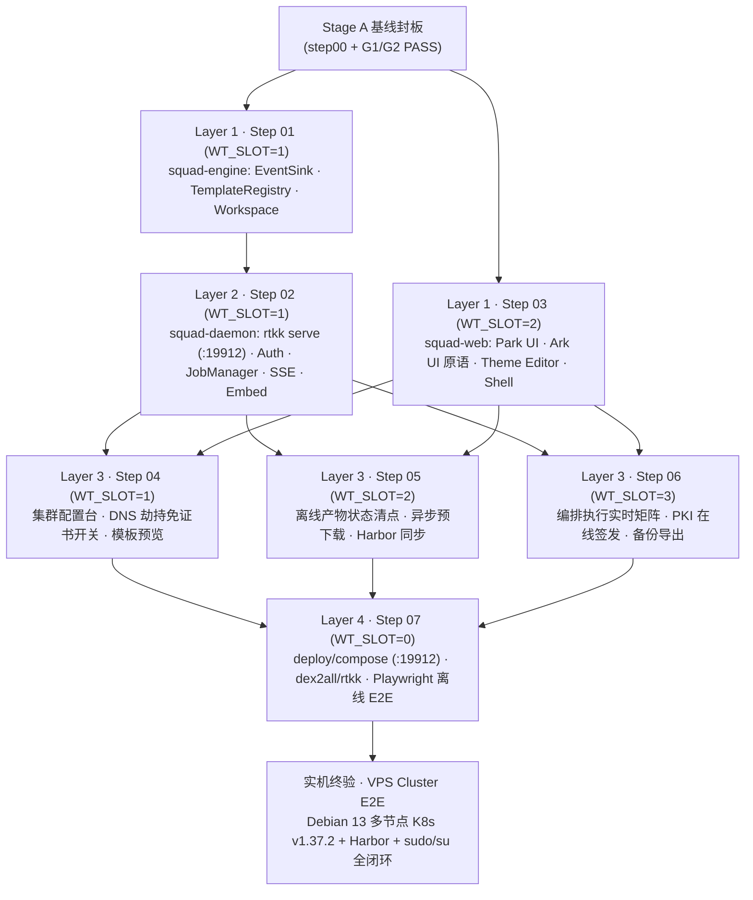

# Phase 1（Stage B）实施总纲：Daemon（`:19912`）· 内嵌 Park UI · 独立 Compose · Docker Hub 自动发版

本目录承载 `rtkk` 从纯 CLI 编排器演进为「**CLI + Daemon 双入口单二进制（默认端口 `:19912`）+ 内嵌离线 Park UI 控制台 + 独立 Docker Compose 部署栈 + `dex2all/rtkk` 自动发布**」的分步工程实施契约。Stage A（Step M1 ～ M4）治理底座已完成归档（见 [migration-records](../phase0-cli-foundation/migration-records/01-STAGE-A-M1-MEMORY-AND-IRON-RULES.md)）。

---

## 1. 全局锁定架构规格

| 决策维度 | 锁定契约 |
| :--- | :--- |
| **二进制双入口** | 单一 `rtkk` 可执行文件保留 `run`、`prep`、`cert`、`pull-images`、`push-images`、`sync-images` 全部 CLI 能力；新增 `rtkk serve`（常驻管理服务）与 `rtkk healthcheck`（探活子命令） |
| **默认监听端口** | 全局锁定 **`19912`**（宿主机直跑默认 `127.0.0.1:19912`；容器内绑定 `0.0.0.0:19912` 并由 Compose 映射 `${RTKK_PORT}:19912`；并发 Worktree 槽位映射 `29912` / `39912` / `49912` / `59912`） |
| **后端技术底座** | Rust `1.100.0`（Edition `2024`）、`tokio 1.43`、`axum 0.8`、`tower-http 0.6`、`subtle 2.6`、`flate2 1.1`；`build.rs` 编译期完成前端静态资源 Gzip 预压缩与 SHA256 ETag 内嵌 |
| **前端设计系统** | React `19` + TypeScript `5.7`（`strict: true`）+ Vite `6` + `@ark-ui/react 5` + Tailwind CSS `v4`；内置 Park UI Light/Dark 双色 Token 与在线 Theme Editor；纯离线系统字体栈与本地 SVG 图标 |
| **容器与发布流水线** | 基于 `debian:13-slim` 非特权账号（`uid=10001, gid=10001`）构建；GitHub Actions 自动推送 `dex2all/rtkk:<ver>` 与 `dex2all/rtkk:latest`，同步发布 `rtkk_<ver>_linux_amd64.tar.gz` 与 `rtkk_<ver>_compose.tar.gz` |

---

## 2. 分步实施方案与预置门禁索引

| 步骤 | 依赖层级 | 实施方案文档 | 协同分队 | 覆盖能力 | 预置门禁脚本 |
| :--- | :---: | :--- | :--- | :--- | :--- |
| **Step 01** | **L1** | [01-STEP01-ENGINE-DECOUPLING-AND-WORKSPACE.md](./01-STEP01-ENGINE-DECOUPLING-AND-WORKSPACE.md) | `orchestrator` + `squad-engine` + `squad-ops-qa` | `C15`、`C16` | [step01.sh](../../../scripts/gate/step01.sh) |
| **Step 02** | **L2** | [02-STEP02-DAEMON-CORE-AUTH-AND-EMBED.md](./02-STEP02-DAEMON-CORE-AUTH-AND-EMBED.md) | `orchestrator` + `squad-daemon` + `squad-ops-qa` | `C17`、`C18`、`C19` | [step02.sh](../../../scripts/gate/step02.sh) |
| **Step 03** | **L1** | [03-STEP03-PARKUI-DESIGN-SYSTEM-AND-SHELL.md](./03-STEP03-PARKUI-DESIGN-SYSTEM-AND-SHELL.md) | `orchestrator` + `squad-web` + `squad-ops-qa` | `C20` | [step03.sh](../../../scripts/gate/step03.sh) |
| **Step 04** | **L3** | [04-STEP04-INVENTORY-STUDIO-AND-PREVIEW.md](./04-STEP04-INVENTORY-STUDIO-AND-PREVIEW.md) | `orchestrator` + `squad-daemon` + `squad-web` + `squad-ops-qa` | `C21`、`C22`、`C23` | [step04.sh](../../../scripts/gate/step04.sh) |
| **Step 05** | **L3** | [05-STEP05-ARTIFACT-PREFETCH-AND-REGISTRY.md](./05-STEP05-ARTIFACT-PREFETCH-AND-REGISTRY.md) | `orchestrator` + `squad-daemon` + `squad-web` + `squad-ops-qa` | `C24`、`C25` | [step05.sh](../../../scripts/gate/step05.sh) |
| **Step 06** | **L3** | [06-STEP06-EXECUTION-CONSOLE-PKI-AND-BACKUPS.md](./06-STEP06-EXECUTION-CONSOLE-PKI-AND-BACKUPS.md) | `orchestrator` + `squad-daemon` + `squad-web` + `squad-ops-qa` | `C26`、`C27` | [step06.sh](../../../scripts/gate/step06.sh) |
| **Step 07** | **L4** | [07-STEP07-COMPOSE-DOCKERHUB-AND-E2E.md](./07-STEP07-COMPOSE-DOCKERHUB-AND-E2E.md) | `squad-ops-qa` + `orchestrator` | `C28`、`C29` | [step07.sh](../../../scripts/gate/step07.sh) |
| **VPS 联调** | **实机终验** | [08-VPS-CLUSTER-ACCEPTANCE-MATRIX.md](./08-VPS-CLUSTER-ACCEPTANCE-MATRIX.md) | `squad-ops-qa` + `orchestrator` | `C01`～`C29` 全栈 | [vps-cluster-e2e.sh](../../../scripts/gate/vps-cluster-e2e.sh) |

---

## 3. 四层并行推进拓扑与 Worktree 槽位编排

---

## 4. 每步合流与门禁递进纪律

1. **契约 PR 先行**：在启动任一步骤的分队 Worktree 之前，由 `orchestrator` 先在主干落盘公共 DTO 签名、将本步路由从 [A4](../../../docs/standards/A4-API-CONTRACT-INDEX.md)「待挂载表」迁入「已挂载表」（针对含新增路由的步骤），并确认 `scripts/gate/stepNN.sh` 就绪。
2. **分队自检闭环**：各分队在独立 `git worktree` 内完成编码后，必须运行 `bash scripts/check-write-scope.sh --role <role>` 与 G1/G2 校验。
3. **递进激活总门禁**：每完成一步合流，`orchestrator` 将该步脚本加入 [scripts/gate/all.sh](../../../scripts/gate/all.sh) 的默认 `ACTIVE_GATES` 列表（例如 Step 02 合流后设为 `step00 step01 step02`），直至 Step 07 合流后串联 `step00..step07` 输出 `ALL GATES PASS`。
4. **虚拟 VPS 实机终验与封存**：待 Debian 13 虚拟 VPS 主机集群准备就绪后，按 [08-VPS-CLUSTER-ACCEPTANCE-MATRIX.md](./08-VPS-CLUSTER-ACCEPTANCE-MATRIX.md) 执行 `bash scripts/gate/vps-cluster-e2e.sh` 跑通实机交付验收，随后将本目录整体归档至 `plans/completed/`。
